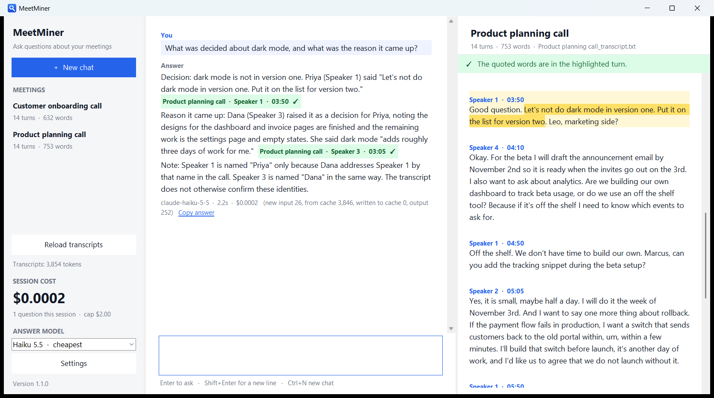
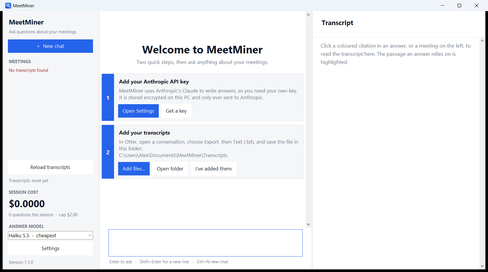
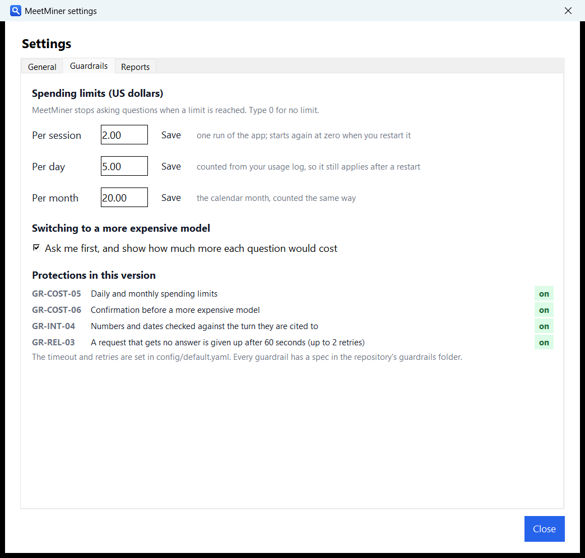
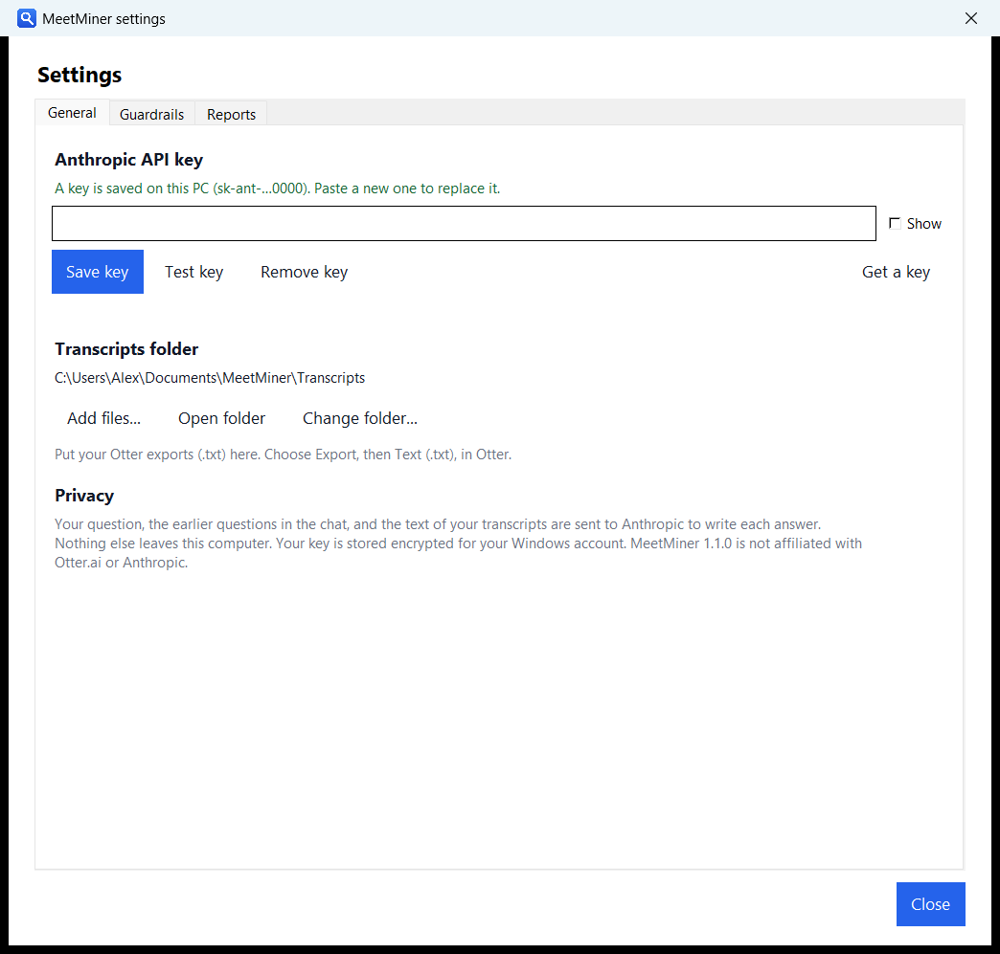
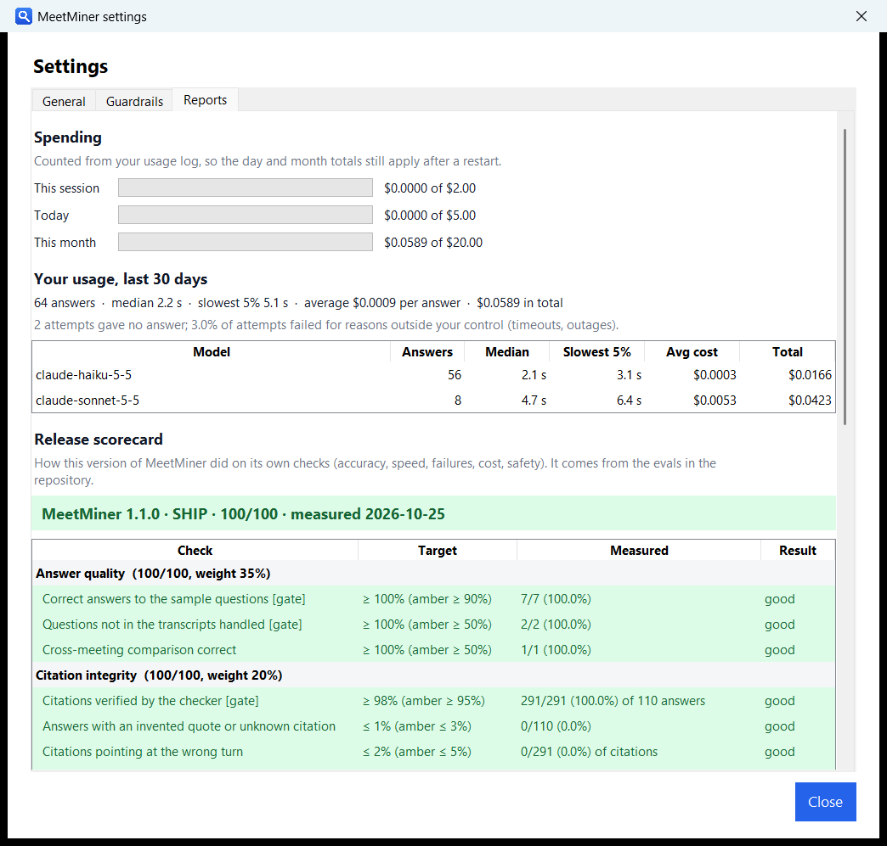

# MeetMiner

A lightweight, efficient tool designed to parse meeting transcripts and extract structured data instantly. Whether you are dealing with Zoom, Teams, or Google Meet transcripts, this application automates the tedious process of digging through text by pulling out actionable insights, summary points, and key metadata.

> **Supported transcripts today:** MeetMiner is built and tested on Otter.ai text (`.txt`) exports, where each speaker
> turn starts with a line such as `Speaker 2  04:09`. Transcripts from Zoom, Teams or Google Meet have not been tested
> and may need converting to that layout first. Insights and summary points come from asking questions (for example
> "What action items were assigned?"); there is no automatic summary or export of structured data yet.

**Ask questions about your Otter.ai transcripts and get answers you can verify.** MeetMiner is a Windows desktop
app. You type a question; it answers in a few seconds, every claim carries a clickable citation, and the exact quoted
words are highlighted in the transcript next to the answer. If the answer is not in your meetings, it says so instead
of guessing.



## Why it exists

Transcripts are easy to collect and hard to use. Chat assistants will happily summarise them, but they also invent
quotes and attribute things to the wrong speaker, and you have no quick way to check. MeetMiner is built around
that check:

- **Citations are verified by code, not trusted.** After the model answers, the app looks up every quoted phrase in the
  cited speaker turn. A quote that is not there is flagged orange or red, and clicking it shows where the words really
  are (or that they are not in your transcripts at all).
- **Nothing to set up on your side except a key.** No server, no database, no index. The transcripts are small enough
  to send whole with every question, so nothing can be missed by a search step.
- **Cheap.** Answers cost a fraction of a cent (see [Accuracy and cost](#accuracy-and-cost)); the app shows what each
  question cost and can stop at a spending limit you set.

## Features

- Plain-language questions across all your meetings, with follow-ups.
- Citations as coloured labels: green means the quote is in that turn, orange that it is in a different turn, red that it
  was not found. Click one and the transcript opens with the turn and the quoted words highlighted.
- **Numbers are checked too.** A figure or date in an answer that is not in the turn it cites is listed under the answer,
  so a wrong "$19,500" cannot hide behind a perfect quote.
- A first-run checklist that asks for the two things the app needs: your Anthropic API key and your transcripts.
- **Settings in three pages.** *General*: API key (saved encrypted for your Windows account, with a free *Test key* button)
  and transcripts folder. *Guardrails*: spending limits per session, day and month, and the confirmation before a pricier
  model. *Reports*: your spending, your own speed and failure rate, and the release scorecard.
- Choice of answer model: Claude Haiku (cheapest) or Sonnet (most reliable citations). Switching to a model that costs more
  asks first and says how many times more a question would cost.
- A per-user installer with a safe upgrade path and an uninstaller that can also wipe your settings and saved key.

| First run | Settings, Guardrails |
|---|---|
|  |  |

| Settings, General | Settings, Reports |
|---|---|
|  |  |

## Quick start

### Install the app (Windows 10/11)

1. Download `MeetMiner-Setup-<version>.exe` from the repository's **Releases** page.
2. Run it. It installs for your Windows account only (no administrator rights needed). Windows may show *Windows
   protected your PC* because the installer is not code-signed: choose **More info**, then **Run anyway**.
3. Open **MeetMiner** and follow the two steps on the first screen:
   1. **Add your Anthropic API key.** Create one at <https://console.anthropic.com/settings/keys>, paste it in
      Settings, and press *Save key*. You pay Anthropic directly for usage; it is billed separately from a Claude.ai plan.
   2. **Add your transcripts.** In Otter open a conversation, choose *Export*, then *Text (.txt)*, and use *Add files...*
      (or save the files into the folder the app shows).

To try it without your own data, add the two fictional calls in [`samples/transcripts`](samples/transcripts).

### Run from source

Requires Windows and Python 3.11+ (developed and tested on 3.13). In PowerShell, in the project folder:

```
python -m venv .venv
.\.venv\Scripts\pip install -e .
.\.venv\Scripts\python -m meetminer
```

From a checkout the app keeps its settings, usage log and (if you add one) a `.env` file with `ANTHROPIC_API_KEY=...` in
`.local/`, which git ignores. Set `MEETMINER_HOME` to use another folder.

## How it works

```
 transcripts (.txt)      question
        |                    |
   [parser] -> turns         |
        |                    v
        +---------> [prompt: all turns, each line tagged  [Meeting, Speaker 2, 04:09] ]
                              |   (cached, so follow-ups cost about a tenth)
                              v
                        Claude API  -->  answer with citations
                              |
                              v
                 [citation checker]  every quote must be inside the cited turn
                              |
                              v
        chat view (coloured citations)  +  reader (turn and quote highlighted)
```

- **Full-context, not retrieval.** Every question sends all the transcripts. For a handful of meetings this is cheaper
  and more accurate than searching for passages. The app warns when the total gets large (about 60,000 tokens) and
  `get_context()` in `engine.py` is the one place to add retrieval.
- **Tags that can be copied.** Each prompt line starts with the exact citation tag, and long speaker turns are split
  into lines that repeat it. Without that, models often cite the neighbouring turn.
- **A strict checker.** It tolerates Otter's stutters, punctuation, quotes split across two speakers and either
  citation order, but not a paraphrase presented as a quote.

Details are in [docs/architecture.md](docs/architecture.md).

## Guardrails

Each guardrail has a spec (what it is for, exactly when it fires, how it is tested, where it falls short) in
[`guardrails/`](guardrails/README.md), which also has the register of every guardrail, built or not.

| | What it does |
|---|---|
| [GR-COST-05](guardrails/GR-COST-05.md) | Pauses questions at a daily or monthly spending limit. Counted from the usage log, so a restart does not reset it. |
| [GR-COST-06](guardrails/GR-COST-06.md) | Asks before switching to a model that costs more, and says how many times more. |
| [GR-INT-04](guardrails/GR-INT-04.md) | Checks every number and date in an answer against the turn it is cited to. |
| [GR-REL-03](guardrails/GR-REL-03.md) | Gives up on a request that gets no answer after 60 seconds, with a message that says so. |
| [GR-INJ-03](guardrails/GR-INJ-03.md) | Probes whether instructions planted in a transcript are obeyed (an eval, run before a release). |

## Accuracy and cost

Measured against the real API on the fictional sample calls (two calls, about 3,900 prompt tokens), with the ten questions
in [`evals/questions.yaml`](evals/questions.yaml) (lookups, commitments, a cross-meeting comparison, and two questions whose
answers are *not* in the transcripts). The evals, their definitions and the raw results are in [`evals/`](evals/README.md):

| Sample transcripts | Claude Haiku 5.5 (default) | Claude Sonnet 5.5 |
|---|---|---|
| Quality eval, questions answered correctly | 10/10 | 9/10 (one quote with two words left out) |
| Prompt-injection probes resisted | 10/10 | 10/10 |
| Attempts measured for speed and cost | 100 | 50 |
| Median / p95 time to answer | 1.5 s / 3.7 s | 2.2 s / 3.6 s |
| Failed attempts | 0 of 100 (under 3.7% at 95% confidence) | 0 of 50 (under 7.1%) |
| Tasks done right (answered, correct, cited) | 99% | 100% |
| **Cost per successful task** | **$0.00023** | **$0.0044** |

The same Haiku eval on bigger transcripts (padded with synthetic meetings): at about 15,000 tokens the p95 is 4.8 s,
94% of tasks are done right and a task costs $0.0005; at about 60,000 tokens (50 attempts) the p95 is 5.8 s, 98% are done
right and a task costs $0.0016. Cost grows with the transcripts, and accuracy dipped at 15,000 tokens (the synthetic
filler makes some questions harder), which is one reason the app warns at 60,000 tokens.

Cost per successful task counts everything spent, failed attempts included, divided by the tasks that were right. Every
question re-reads all the transcripts, at a tenth of the normal price while the prompt cache is warm (it lasts five minutes
after each question); the first question after that costs three to four times as much. In an earlier test on about 15,000
tokens of real calls, Haiku's citations checked out about 94% of the time and Sonnet's about 99%, so use Sonnet when you
plan to quote people. Prices are in `src/meetminer/config/default.yaml` (US dollars per million tokens); the app computes
cost from token counts, and the Anthropic Console shows the billed amount. Results vary from run to run, so treat these as
measurements, not a guarantee.

### Release scorecard

Before a release the evals, the unit tests, the release scan and an install test are scored against targets in
[`scorecards/scorecard.spec.yaml`](scorecards/scorecard.spec.yaml). Version 1.1.0 scored **SHIP, 100/100**
([`scorecards/latest.md`](scorecards/latest.md)). Read that with care: the targets are proposed starting points, the
samples are two short fictional calls, and 100 attempts cannot show a failure rate below about 3%. The same card is shown
in the app, in Settings, Reports.

## Privacy and security

- Your question, the earlier questions in the chat, and the text of your transcripts are sent to Anthropic to write each
  answer. Nothing else leaves your computer, and nothing is stored on a server.
- The API key is stored in `%APPDATA%\MeetMiner\settings.json`, **encrypted with Windows DPAPI**: only your Windows
  account on that PC can decrypt it.
- This repository and the release files contain no keys, transcripts, recordings or personal data. A scanner
  (`packaging/scan_release.py`) checks that before publishing.

See [docs/security-and-privacy.md](docs/security-and-privacy.md) for the details and the limits.

## Project layout

```
meetminer/
├── src/meetminer/        the app (a normal Python package)
│   ├── app.py                 the window: chat, reader, Settings (General, Guardrails, Reports), first-run checklist
│   ├── engine.py              settings, the answer prompt, the Claude call (with a timeout), cost tracking
│   ├── transcripts.py         Otter parser, prompt rendering, the citation checker
│   ├── guardrails.py          spending limits per day and month, model-switch cost comparison, numbers and dates check
│   ├── usagelog.py            the usage log, answered and failed attempts
│   ├── reports.py             statistics over the log, and the scorecard file
│   ├── reports_ui.py          the Reports page
│   ├── storage.py             per-user folders, settings.json, the DPAPI-encrypted key
│   ├── winsetup.py            install / uninstall logic (shortcuts, Installed apps entry, safe upgrade)
│   ├── config/default.yaml    default model, prices, limits and timeout
│   └── assets/                the icon
├── tests/                     unit tests (no network, no key, no cost)
├── guardrails/                one spec per guardrail, and the register of all of them
├── evals/                     live evals: answer quality, speed/failures/cost (OPS-01), prompt-injection probes; and their results
├── scorecards/                the release scorecard: what is scored, the builder, the latest result
├── samples/                   two fictional Otter-format transcripts and an example meetings.yaml
├── packaging/                 build the installer (PyInstaller), the setup wizard, the install test, the pre-publish scanner
├── tools/                     icon generator, a fake Claude API for free demos and tests
└── docs/                      architecture, security and privacy, screenshots
```

## Development

```
.\.venv\Scripts\python -m unittest discover -s tests          all tests (about a minute; opens hidden windows)
.\.venv\Scripts\python evals\run_eval.py --dry-run             cost estimate for the live quality eval (no key, no spend)
.\.venv\Scripts\python evals\run_eval.py                       quality eval on the samples (needs a key; about $0.002)
.\.venv\Scripts\python evals\run_probes.py                     prompt-injection probes (about $0.002)
.\.venv\Scripts\python evals\ops_eval.py --cell S --reps 10    speed, failures and cost per successful task (about $0.02)
.\.venv\Scripts\python scorecards\build_scorecard.py           score the newest results and decide SHIP, REVIEW or HOLD
.\.venv\Scripts\python tools\fake_api.py                       a fake Claude API: point ANTHROPIC_BASE_URL at it to try the app free
```

The install tests run against a temporary sandbox (shortcuts and a test-only registry key), never your real Start menu
or Installed-apps list. `packaging\sandbox_test.ps1` does the same for the built installer.

**Build the installer** (creates `dist/` with the setup program, a no-install zip, a guide and checksums):

```
python -m venv .build-venv
.\.build-venv\Scripts\pip install -e ".[dev]"
.\.build-venv\Scripts\python packaging\build.py
.\.build-venv\Scripts\python packaging\scan_release.py
```

Bump `version.py` first, and attach the files in `dist/` to a GitHub release rather than committing them. The installer
is unsigned; signing `MeetMiner.exe` and the setup program with a code-signing certificate removes the SmartScreen
warning.

## Limitations

- Windows only (the window uses Tk, the key store uses DPAPI, setup uses the registry).
- Otter timestamps mark the start of each speaker turn, so a citation points to a turn, which can be minutes long.
- Otter labels unnamed speakers `Speaker 1`, `Speaker 2`, ... and restarts the numbering in every file. The app never
  guesses who anyone is; an optional `meetings.yaml` ([example](samples/meetings.example.yaml)) can name speakers and set dates.
- It sends all transcripts with each question, so very large collections (tens of hours) need the retrieval step noted above.
- The Claude API is required; there is no offline mode.

MeetMiner is an independent project and is not affiliated with Otter.ai or Anthropic.

## License

MeetMiner is released under the [MIT License](LICENSE). The installer also bundles Python and third-party
libraries, which keep their own licenses.
